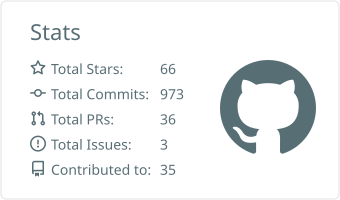
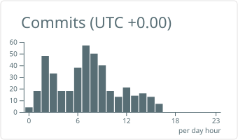
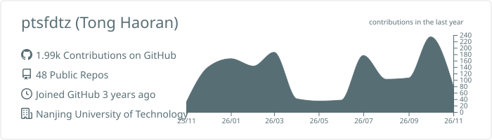
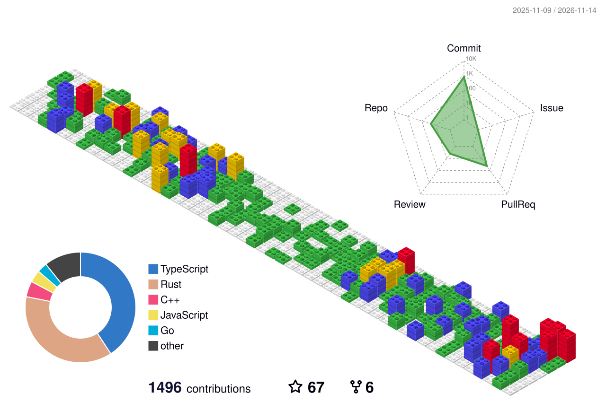

- 👋 Hi, I’m [@ptsfdtz](https://github.com/ptsfdtz) · Tong Haoran

- 📍 Nanjing, China · 🎓 NJTECH

## Token Usage Stats

<a href="https://tokens.ci/u/ptsfdtz">
  <picture>
    <source media="(prefers-color-scheme: dark)" srcset="https://tokens.ci/api/embed/ptsfdtz/svg?today=1&amp;template=graph&amp;rank=percent&amp;tokens=compact&amp;cost=compact">
    <source media="(prefers-color-scheme: light)" srcset="https://tokens.ci/api/embed/ptsfdtz/svg?theme=light&amp;today=1&amp;template=graph&amp;rank=percent&amp;tokens=compact&amp;cost=compact">
    
  </picture>
</a>

## GitHub Stats

<!-- Contribution snake: generated daily by .github/workflows/main.yml. -->
<picture>
  <source media="(prefers-color-scheme: dark)" srcset="https://raw.githubusercontent.com/ptsfdtz/ptsfdtz/output/github-contribution-grid-snake-dark.svg">
  <source media="(prefers-color-scheme: light)" srcset="https://raw.githubusercontent.com/ptsfdtz/ptsfdtz/output/github-contribution-grid-snake.svg">
  
</picture>

<!-- Preserve the Stats + Commits (UTC +0.00) cards from the original layout. -->
<picture>
  <source media="(prefers-color-scheme: dark)" srcset="https://raw.githubusercontent.com/ptsfdtz/ptsfdtz/summary-cards/profile-summary-card-output/blueberry/3-stats.svg">
  
</picture>
<picture>
  <source media="(prefers-color-scheme: dark)" srcset="https://raw.githubusercontent.com/ptsfdtz/ptsfdtz/summary-cards/profile-summary-card-output/blueberry/4-productive-time.svg">
  
</picture>

<picture>
  <source media="(prefers-color-scheme: dark)" srcset="https://raw.githubusercontent.com/ptsfdtz/ptsfdtz/summary-cards/profile-summary-card-output/blueberry/0-profile-details.svg">
  
</picture>

## 3D Contributions

<!-- Generated daily by the profile-3d job in .github/workflows/main.yml. -->

